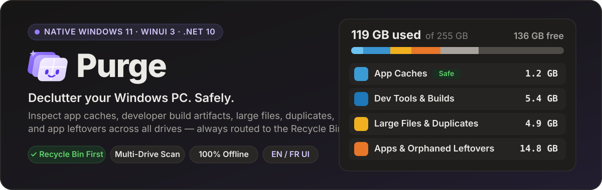
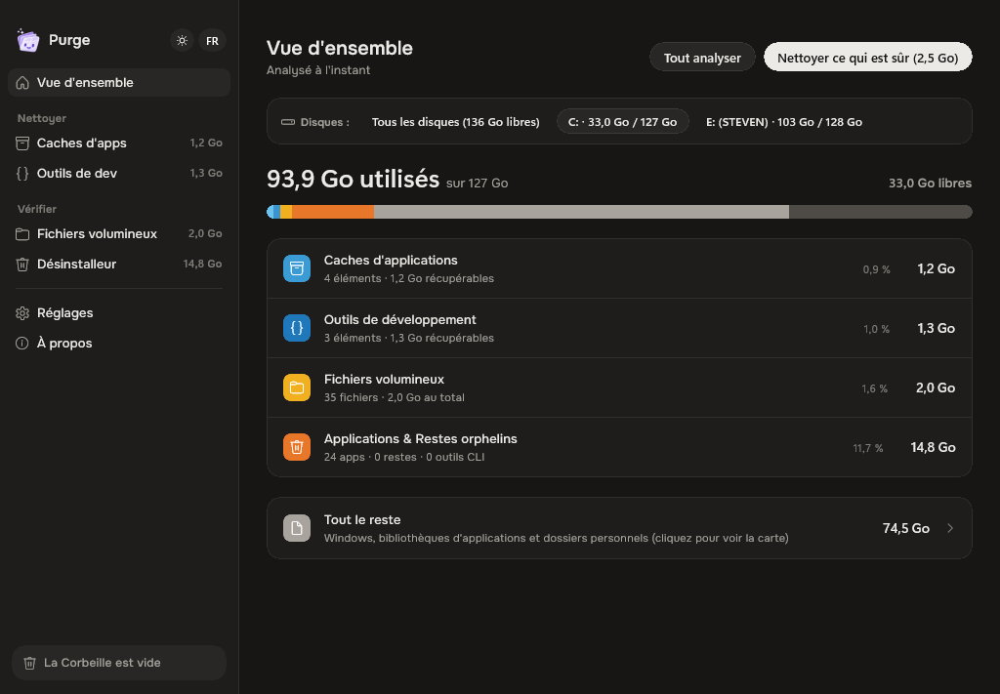
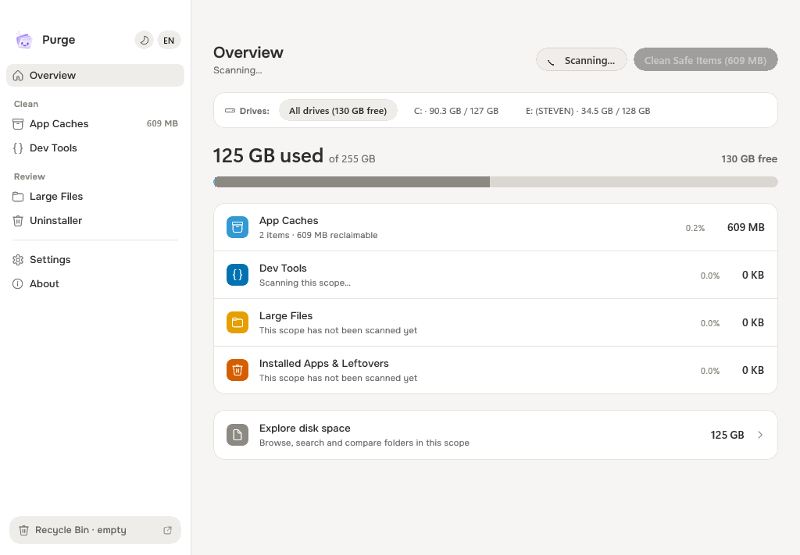
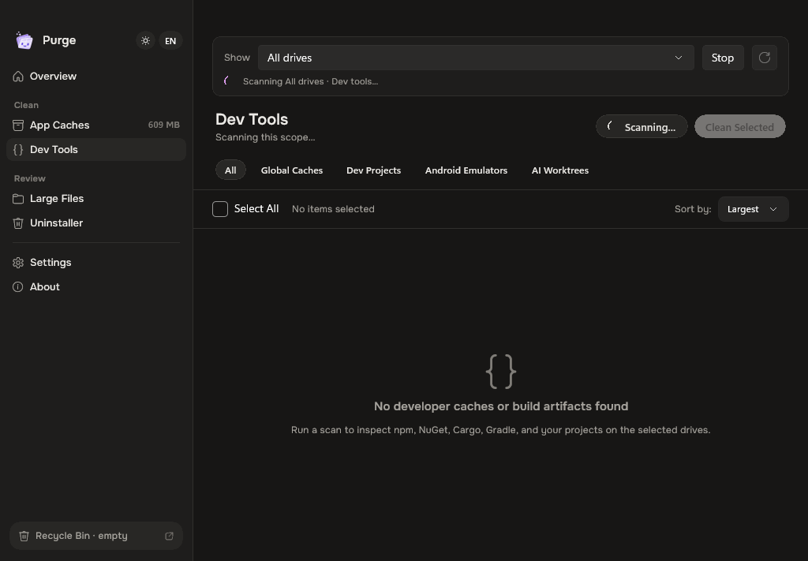
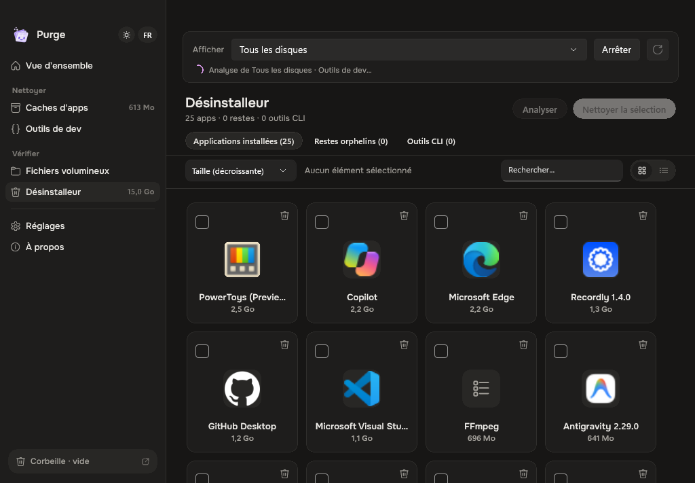
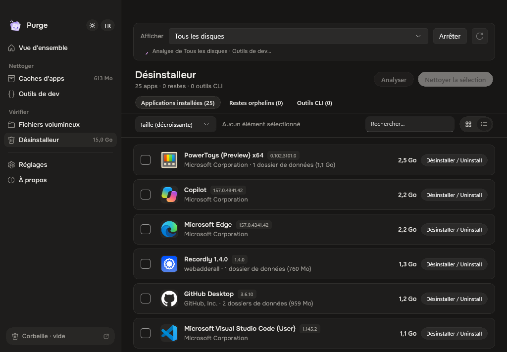
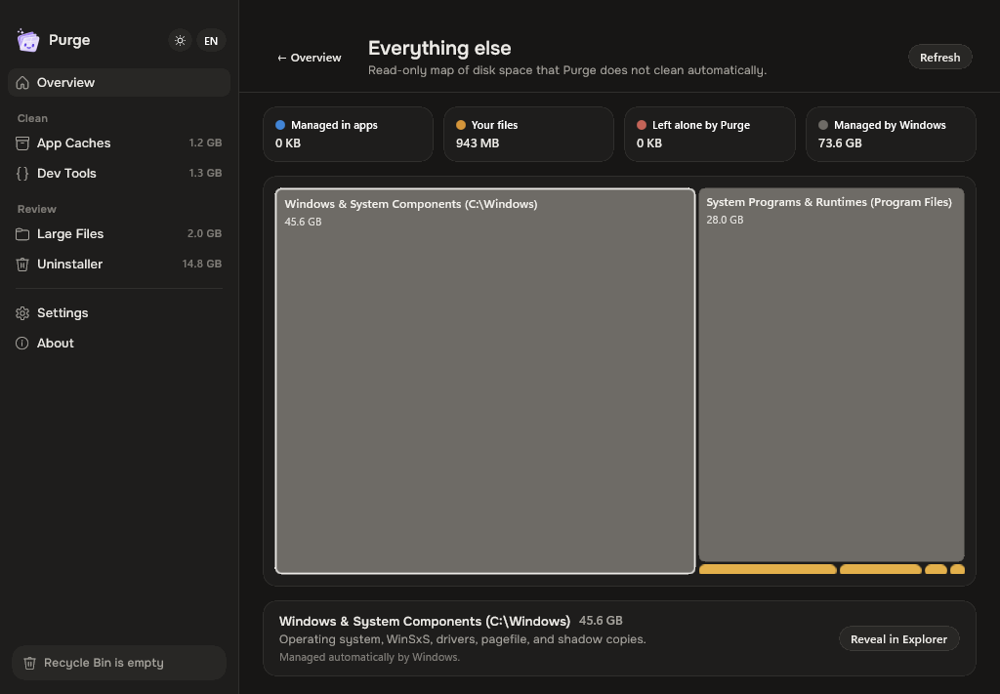
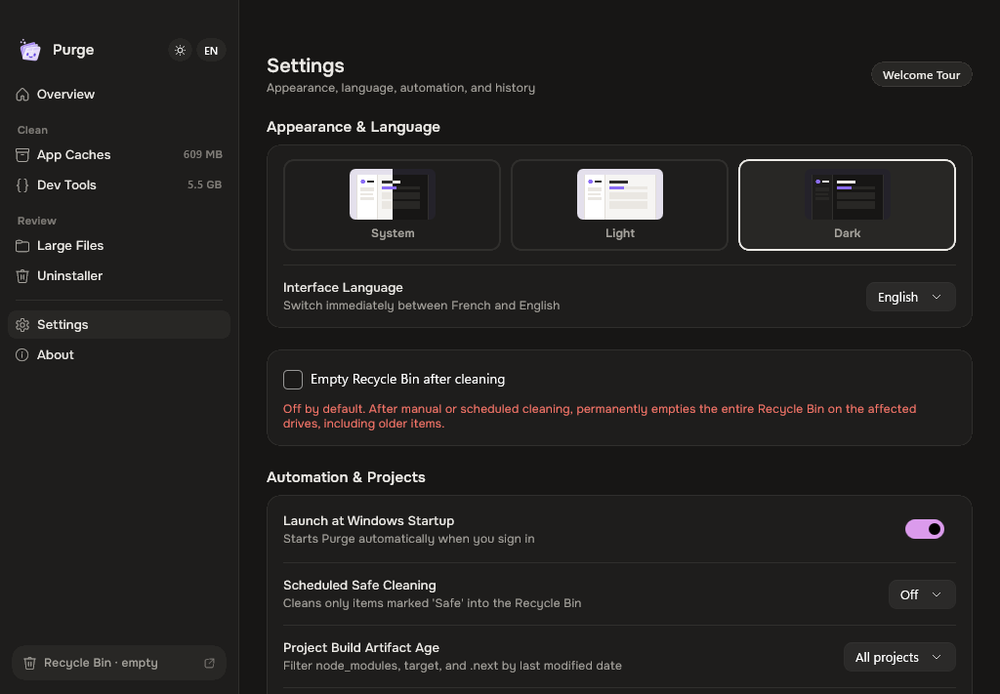
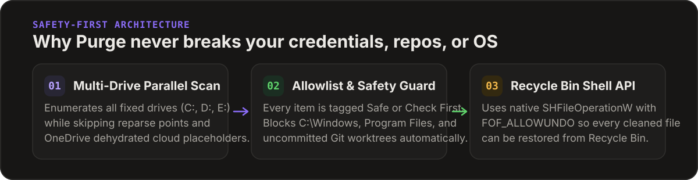

<p align="center">
  
</p>

<p align="center">
  <a href="./README.md">English</a> · <strong>Français</strong> · <a href="https://github.com/stvekoulo/purge/releases/latest"><strong>⬇ Télécharger la dernière version</strong></a>
</p>

<p align="center">
  <a href="https://github.com/stvekoulo/purge/releases/latest"></a>
  
  
  
  
  <a href="./LICENSE"></a>
</p>

---

## Aperçu réel de l'application

<p align="center">
  
</p>

<p align="center">
  
  
</p>

<p align="center">
  
  
</p>

<p align="center">
  
  
</p>

---

## Qu'est-ce que Purge ?

**Purge** est un analyseur d'espace disque, nettoyeur de caches système et nettoyeur d'artefacts de développement natif **WinUI 3** pour **Windows 11 et Windows 10**. Il inspecte tous vos disques locaux (`C:`, `D:`, `E:`, ou l'ensemble des disques combinés) et répartit l'espace récupérable en cinq catégories claires — accompagnées d'une carte proportionnelle (Treemap) de tout le reste de votre PC.

Chaque élément est documenté en langage clair pour expliquer son rôle et l'effet de son nettoyage. **Par défaut, les éléments nettoyés sont envoyés dans la Corbeille de Windows.** Leur déplacement ne libère pas immédiatement d'espace disque ; l'option de vidage définitif exige une activation explicite et concerne aussi les anciens éléments de la Corbeille.

---

## Pourquoi Purge est différent

<p align="center">
  
</p>

| Principe | Garantie technique |
| :--- | :--- |
| **Corbeille par défaut** | Utilise l'API native Windows Shell `SHFileOperationW` (`FOF_ALLOWUNDO`) afin que chaque fichier ou dossier nettoyé puisse être restauré depuis la Corbeille à tout moment. |
| **Liste blanche stricte (Allowlist)** | Seuls les emplacements vérifiés dans [`windows-cache-catalog.json`](./Resources/windows-cache-catalog.json) sont éligibles au nettoyage sûr en un clic. Les mots de passe, sessions, cookies et clés SSH/GPG ne sont jamais touchés. |
| **Analyse & sélecteur multi-disques** | Analysez tous vos disques (`Tous les disques`) simultanément ou basculez d'un clic entre vos disques individuels (`C:`, `D:`, `E:`). |
| **Conçu pour les développeurs** | Détecte les caches globaux (`npm`, `pnpm`, `Yarn`, `Bun`, `NuGet`, `Cargo`, `pip`, `uv`, `Gradle`, `Maven`, `Go`, `JetBrains`, `VS Code`, `Cursor`) et les dossiers de build (`node_modules`, `target`, `.next`, `dist`, `bin/obj`, `.venv`, émulateurs Android AVD et worktrees IA orphelins). |
| **Désinstallateur avec icônes natives** | Extraction d'icônes haute résolution (catalogue de 83+ applications de marque + Registre Windows + raccourcis Démarrer), bascule Grille (`[ ⊞ ]`) et Liste (`[ ≡ ]`), tri dynamique (`Plus volumineux`, `Moins volumineux`, `Nom A-Z`), et dialogue lançant le désinstalleur enregistré sous Windows. |
| **Exécution en arrière-plan (Zone de notification)** | Se réduit proprement dans la zone de notification système Windows (`Shell_NotifyIconW`) pour un accès rapide et une surveillance discrète. |
| **Respect de OneDrive & des liens NTFS** | Ne traverse jamais les jonctions ou liens symboliques NTFS et permet de libérer l'espace local des fichiers OneDrive (`attrib +U -P`) tout en les conservant dans le cloud. |
| **Confidentialité & bilingue** | Nettoyage local sans télémétrie ; vérification facultative des mises à jour sur GitHub. Bascule instantanée **Français / English** et thèmes **Clair / Sombre / Système**. |

---

## Comparatif avec les nettoyeurs traditionnels sous Windows

| Fonctionnalité | **Purge** | CCleaner | BleachBit | WinDirStat / WizTree | `npkill` |
| :--- | :---: | :---: | :---: | :---: | :---: |
| **Déplacement vers la Corbeille par défaut** | **Oui** | Non | Non | Manuel | Non (`rm -rf`) |
| **Caches de développement & `node_modules` / `target` / `NuGet`** | **Oui** | Non | Partiel | Manuel | `node_modules` seul |
| **Modèles IA locaux (`Ollama`, `LM Studio`, Hugging Face `.gguf`)** | **Oui** | Non | Non | Manuel | Non |
| **Carte Treemap interactive proportionnelle** | **Oui** | Non | Non | Oui | Non |
| **Détecteur de doublons cryptographique SHA-256** | **Oui** | Payant | Non | Non | Non |
| **Détecteur de restes orphelins `%APPDATA%`** | **Oui** | Non | Non | Non | Non |
| **Extraction d'icônes d'apps & feuille de révision** | **Oui** | Non | Non | Non | Non |
| **Barre de sélection multi-disques (`Tous`, `C:`, `E:`)** | **Oui** | Partiel | Non | Oui | Non |
| **Surveillance dans la zone de notification (Tray)** | **Oui** | Oui (Adware) | Non | Non | Non |
| **100 % Open Source, sans pub, zéro télémétrie** | **Oui (MIT)** | Non | Oui | Oui / Non | Oui |

---

## Cinq modules spécialisés + Carte Treemap

1. **Vue d'ensemble & Treemap Tout le reste** — Barre de stockage 7 segments Okabe-Ito à fort contraste sur tous vos disques, associée à une carte proportionnelle squarifiée (Bruls–Huizing–van Wijk) classant le reste du disque (*Géré par les applications*, *Vos fichiers*, *Non touché par Purge*, *Géré par Windows*).
2. **Caches d'applications** — Caches de navigateurs (Chrome, Edge, Brave, Opera, Firefox), caches graphiques DirectX / GPU (NVIDIA, AMD, Intel), fichiers temporaires Windows et rapports d'erreur, Discord, Slack, Teams, Figma, Notion, Spotify, Steam, Adobe Media Cache, et programmes d'installation Electron en attente.
3. **Outils de développement** — Caches de paquets globaux, artefacts de build filtrables par ancienneté (`Tous`, `> 30j`, `> 90j`, `> 180j`), émulateurs Android Studio AVD et worktrees d'agents IA orphelins avec protection anti-perte git.
4. **Fichiers volumineux, modèles IA & Doublons** — Analyse multi-threadée (`>= 5 Mo`) avec filtres thématiques (*Vidéos*, *Archives*, *Images disque*, *Machines virtuelles*, *Modèles IA* tels qu'Ollama, LM Studio ou Hugging Face `.gguf`/`.safetensors`, *OneDrive*, et détection des doublons en deux passes avec bouton **Garder un seul exemplaire**).
5. **Désinstallateur, restes orphelins & outils CLI** — Analyse des logiciels installés avec extraction de leurs icônes réelles, affichage en Grille (`AppTile`) ou Liste (`AppListRow`), tri par taille et nom, détection des dossiers orphelins dans `AppData` et `ProgramData`, inventaire des exécutables CLI (`.cargo\bin`, `go\bin`, `.dotnet\tools`, `scoop\shims`), et dialogue de confirmation déplaçant les données vers la Corbeille.

---

## Télécharger ou compiler depuis les sources

### Option 1 — Installateurs officiels Windows (`Setup.exe`)

| Architecture | Installateur (`.exe`) | Systèmes cibles |
| :--- | :--- | :--- |
| **x64 (64 bits)** | [Dernier installateur x64](https://github.com/stvekoulo/purge/releases/latest) | PC Windows 10/11 Intel & AMD 64 bits |
| **ARM64** | [Dernier installateur ARM64](https://github.com/stvekoulo/purge/releases/latest) | Snapdragon X Elite / Plus, Surface Pro, Windows on ARM |
| **x86 (32 bits)** | [Dernier installateur x86](https://github.com/stvekoulo/purge/releases/latest) | Systèmes et machines virtuelles Windows 32 bits |

Lancez l'installateur (`Purge-Setup-*.exe`) correspondant à votre architecture pour installer Purge avec raccourci Menu Démarrer, icône Bureau et désinstalleur Windows intégré.

### Option 2 — Compiler depuis les sources

- **Windows 10** (build 19041+) ou **Windows 11** (x64 ou ARM64)
- **.NET 10 SDK** (`10.0.100` ou plus récent)

```powershell
# Cloner le dépôt
git clone https://github.com/stvekoulo/purge.git
cd purge

# Compiler le projet (x64)
dotnet build PurgeWin.csproj -p:Platform=x64

# Lancer Purge
dotnet run --project PurgeWin.csproj -p:Platform=x64
```

### Options en ligne de commande

| Paramètre | Description |
| :--- | :--- |
| *(aucun)* | Lance l'interface graphique native WinUI 3 complète. |
| `--scheduled-clean` | Mode silencieux en arrière-plan (Planificateur de tâches Windows) : nettoie uniquement les caches de niveau `Safe` vers la Corbeille. |
| `--selftest` | Exécute une passe d'auto-vérification complète de tous les scanners, onglets, thèmes et langues, puis quitte avec le code `0`. |

---

## Raccourcis clavier

| Raccourci | Action |
| :--- | :--- |
| `Ctrl + R` | Analyser la catégorie active |
| `Ctrl + Shift + R` | Analyser toutes les catégories sur les disques actifs |
| `Ctrl + 1` … `Ctrl + 5` | Basculer entre *Vue d'ensemble*, *Caches*, *Outils de dev*, *Fichiers volumineux* et *Désinstallateur* |

---

## Licence

Distribué sous [Licence MIT](./LICENSE).
