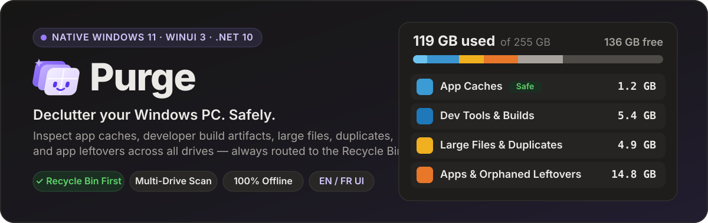
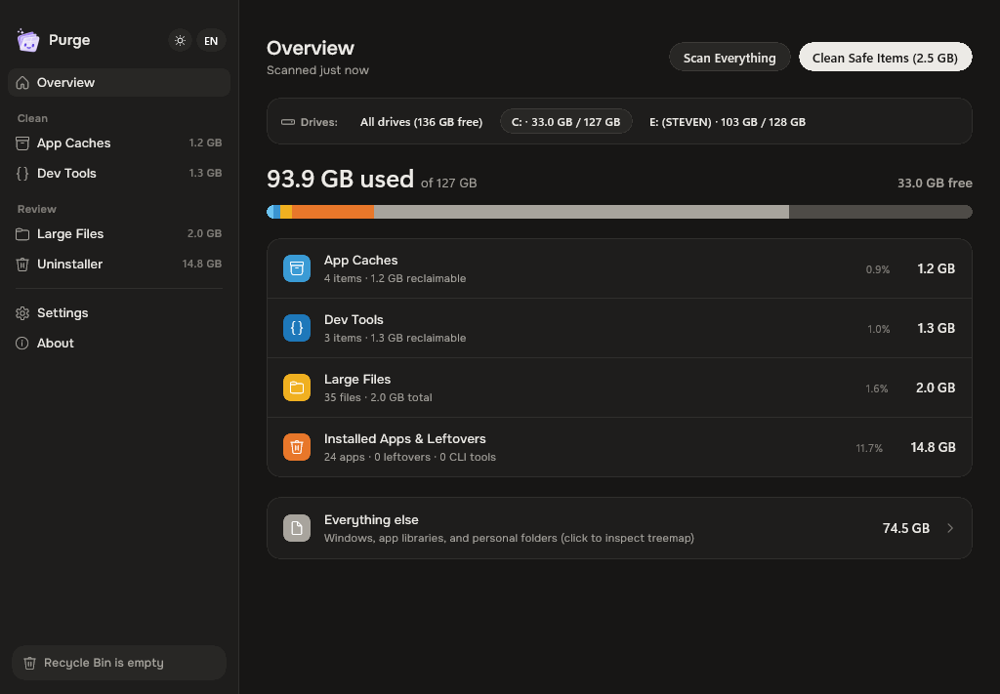
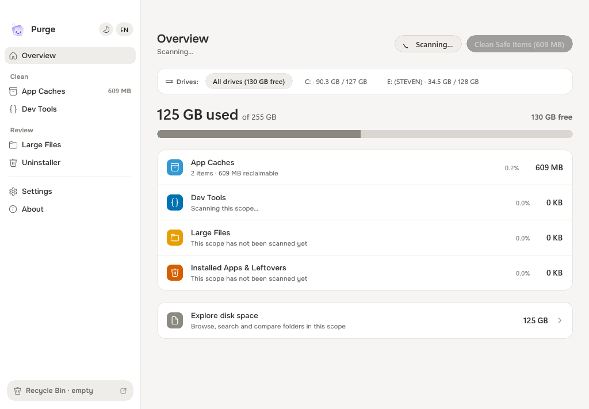
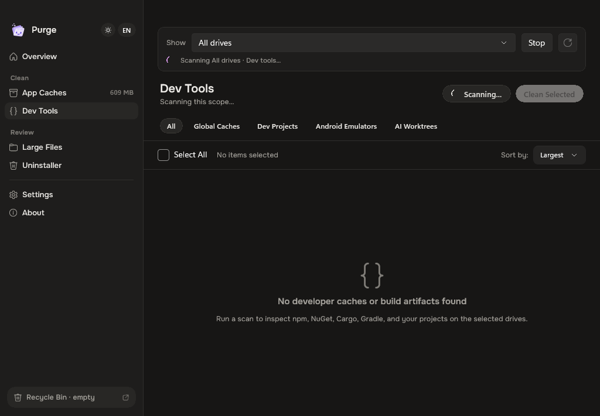
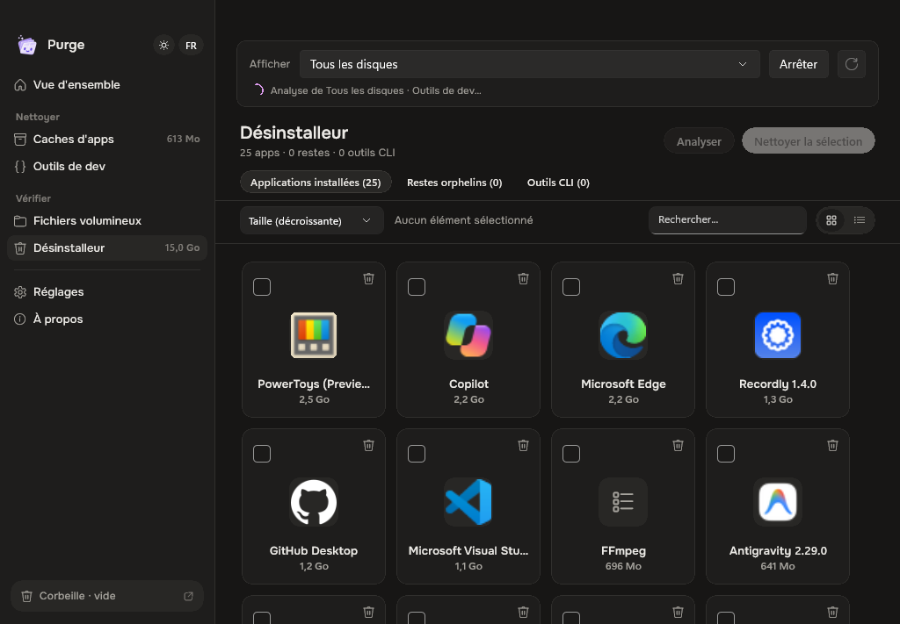
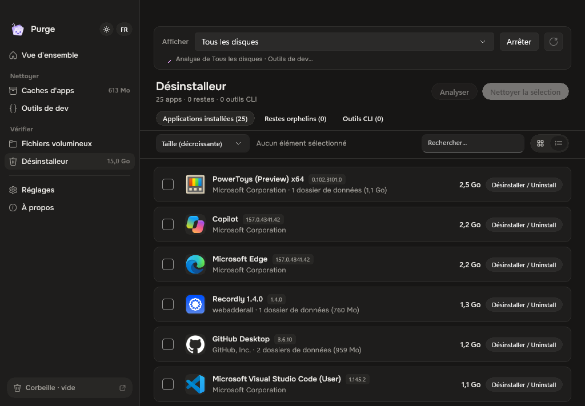
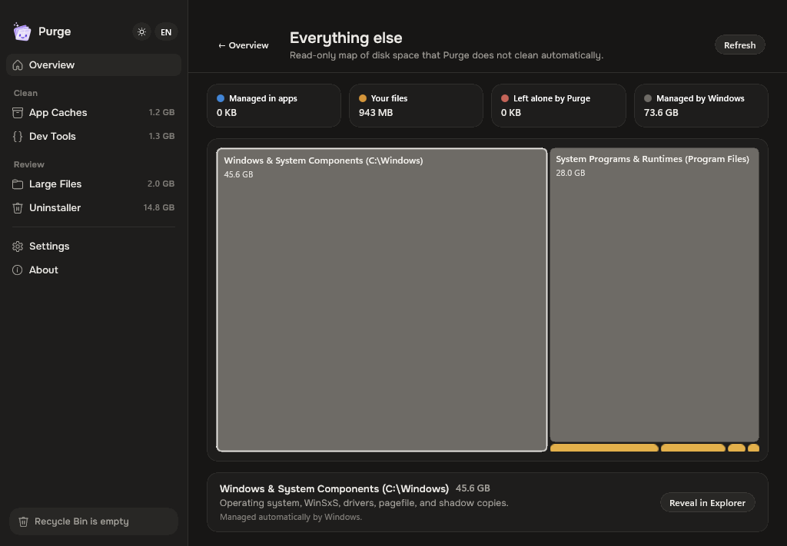
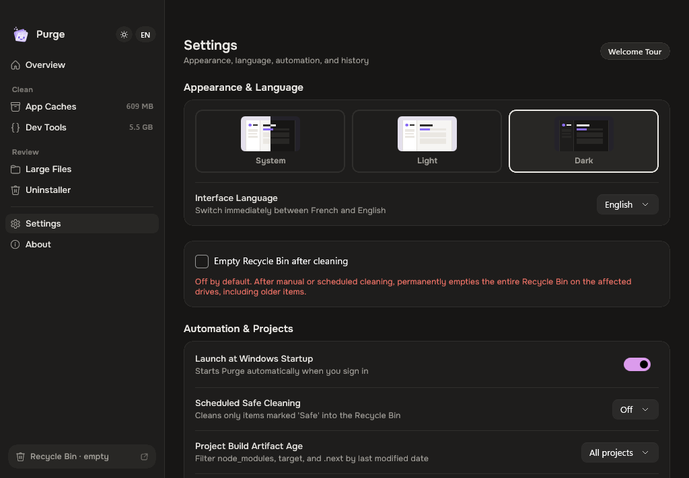
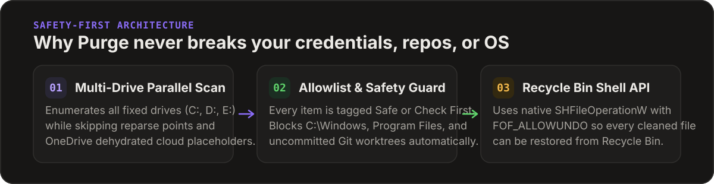

<p align="center">
  
</p>

<p align="center">
  <strong>English</strong> · <a href="./README.fr.md">Français</a> · <a href="https://github.com/stvekoulo/purge/releases/latest"><strong>⬇ Download Latest Release (v1.0.7)</strong></a>
</p>

<p align="center">
  <a href="https://github.com/stvekoulo/purge/releases/latest"></a>
  
  
  
  
  <a href="./LICENSE"></a>
</p>

---

## Real Interface Preview

<p align="center">
  
</p>

<p align="center">
  
  
</p>

<p align="center">
  
  
</p>

<p align="center">
  
  
</p>

---

## What is Purge?

**Purge** is a fast, open-source, native **WinUI 3** disk space analyzer, system cache cleaner, and developer artifact cleaner for **Windows 11 and Windows 10**. It inspects all your local drives (`C:`, `D:`, `E:`, or all drives combined) and breaks down reclaimable disk space into five clear categories—paired with an interactive squarified treemap of everything else on your PC.

Every item displays a plain-language explanation of what it is and what happens after you clean it. Nothing is permanently erased behind your back: **all cleaned files are moved to the Windows Recycle Bin first**.

---

## Why Purge is Different

<p align="center">
  
</p>

| Principle | How Purge Enforces It |
| :--- | :--- |
| **Recycle Bin by Default** | Uses native Windows Shell `SHFileOperationW` (`FOF_ALLOWUNDO`) so cleaned caches, build folders, and leftovers can be restored at any time. |
| **Strict Allowlist Policy** | Only verified cache locations in [`windows-cache-catalog.json`](./Resources/windows-cache-catalog.json) are eligible for one-click safe cleaning. Browser passwords, cookies, sessions, and SSH/GPG keys are never touched. |
| **Multi-Drive Scanning & Bar** | Scan all fixed and removable volumes (`All drives`) at once or switch with single-click pills between individual drives (`C:`, `D:`, `E:`). |
| **Developer-First Intelligence** | Finds global package caches (`npm`, `pnpm`, `Yarn`, `Bun`, `NuGet`, `Cargo`, `pip`, `uv`, `Gradle`, `Maven`, `Go`, `JetBrains`, `VS Code`, `Cursor`) and stale project build folders (`node_modules`, `target`, `.next`, `dist`, `bin/obj`, `.venv`, Android AVDs, and orphaned AI git worktrees). |
| **App Uninstaller with Icons** | Native high-res app icon extraction (83+ branded apps catalogue + Windows Registry + Start Menu shims), Grid (`[ ⊞ ]`) and List (`[ ≡ ]`) view switcher, dynamic sorting (`Largest`, `Smallest`, `Name A-Z`), and an interactive uninstallation review sheet. |
| **Background System Tray** | Minimizes smoothly to the Windows taskbar system notification tray (`Shell_NotifyIconW`) for quick access and background cleanup monitoring. |
| **Cloud & Reparse-Point Safe** | Never traverses NTFS junctions/symlinks during sizing and detects OneDrive cloud-only files (`FILE_ATTRIBUTE_RECALL_ON_DATA_ACCESS`) with one-click local cache eviction (`attrib +U -P`). |
| **100% Offline & Bilingual** | Zero telemetry, zero network requests, instant **English / Français** switching, and adaptive **Dark / Light / System** themes. |

---

## How Purge Compares to Traditional Windows Cleaners

| Capability | **Purge** | CCleaner | BleachBit | WinDirStat / WizTree | `npkill` |
| :--- | :---: | :---: | :---: | :---: | :---: |
| **Moves to Recycle Bin by default** | **Yes** | No | No | Manual | No (`rm -rf`) |
| **Developer Caches & `node_modules` / `target` / `NuGet`** | **Yes** | No | Partial | Manual | `node_modules` only |
| **Local AI Models (`Ollama`, `LM Studio`, `Hugging Face` `.gguf`)** | **Yes** | No | No | Manual | No |
| **Squarified Treemap Disk Visualizer** | **Yes** | No | No | Yes | No |
| **SHA-256 Duplicate File Finder** | **Yes** | Paid | No | No | No |
| **Orphaned `%APPDATA%` Leftover Detector** | **Yes** | No | No | No | No |
| **Native App Icon Extraction & Review Sheet** | **Yes** | No | No | No | No |
| **Multi-Drive Pill Bar Selector** | **Yes** | Partial | No | Yes | No |
| **Background System Tray Monitor** | **Yes** | Yes (Adware) | No | No | No |
| **100% Open Source, No Ads, Zero Telemetry** | **Yes (MIT)** | No | Yes | Yes / No | Yes |

---

## Five Focused Modules + Squarified Treemap

1. **Overview & Everything Else Treemap** — High-contrast Okabe-Ito 7-segment storage bar across your drives, paired with a read-only Bruls–Huizing–van Wijk squarified treemap that classifies the rest of your disk into *Managed in Apps*, *Your Files*, *Left Alone by Purge*, and *Managed by Windows*.
2. **App Caches** — Browser caches (Chrome, Edge, Brave, Opera, Firefox), DirectX & GPU shader caches (NVIDIA, AMD, Intel), Windows Temp & WER reports, Discord, Slack, Teams, Figma, Notion, Spotify, Steam, Adobe Media Cache, and staged Electron updaters.
3. **Dev Tools** — Global toolchain caches, stale project build artifacts filterable by age (`All`, `> 30d`, `> 90d`, `> 180d`), Android Studio AVDs, and orphaned AI agent worktrees (`.claude/worktrees`, `.cursor/worktrees`, `.codex/worktrees`) with dirty-git-status protection.
4. **Large Files, AI Models & Duplicates** — Multi-threaded scanner (`>= 5 MB`) with category filters (*Videos*, *Archives*, *Disk Images*, *Virtual Machines*, *AI Models* like Ollama/LM Studio/Hugging Face `.gguf`/`.safetensors`, *OneDrive*, and two-stage partial+SHA-256 *Duplicates* with **Keep One of Each**).
5. **Uninstaller, Orphaned Leftovers & CLI Tools** — Inspects installed desktop apps with native icon extraction, offers Grid (`AppTile`) and List (`AppListRow`) view switching, dynamic sorting, detects orphaned `%APPDATA%` / `%LOCALAPPDATA%` folders, lists standalone CLI binaries in `.cargo\bin`, `go\bin`, `.dotnet\tools`, and `scoop\shims`, and features an interactive safety review sheet sending leftovers to the Recycle Bin.

---

## Download or Build from Source

### Option 1 — Official Windows Installers (`Setup.exe`)

| Architecture | Installer (`.exe`) | Target Systems |
| :--- | :--- | :--- |
| **x64 (64-bit)** | [`Purge-1.0.7-win-x64-Setup.exe`](https://github.com/stvekoulo/purge/releases/latest) | Standard Intel & AMD 64-bit Windows 10/11 PCs |
| **ARM64** | [`Purge-1.0.7-win-arm64-Setup.exe`](https://github.com/stvekoulo/purge/releases/latest) | Snapdragon X Elite / Plus, Surface Pro, Windows on ARM |
| **x86 (32-bit)** | [`Purge-1.0.7-win-x86-Setup.exe`](https://github.com/stvekoulo/purge/releases/latest) | Legacy 32-bit Windows 10 systems & VMs |

Run the installer (`Purge-Setup-*.exe`) for your architecture to install Purge into the Start Menu, optional Desktop shortcut, and Windows Installed Apps.

### Option 2 — Build from Source

- **Windows 10** (build 19041+) or **Windows 11** (x64 or ARM64)
- **.NET 10 SDK** (`10.0.100` or later)

```powershell
# Clone the repository
git clone https://github.com/stvekoulo/purge.git
cd purge

# Restore dependencies and build (x64)
dotnet build PurgeWin.csproj -p:Platform=x64

# Launch Purge
dotnet run --project PurgeWin.csproj -p:Platform=x64
```

### Command-Line Flags

| Flag | Description |
| :--- | :--- |
| *(none)* | Launches the full WinUI 3 desktop interface. |
| `--scheduled-clean` | Headless background mode registered by Windows Task Scheduler (`PurgeScheduledClean`): scans only verified `Safe` caches and moves them to the Recycle Bin. |
| `--selftest` | Runs an automated end-to-end verification pass across all scanners, tabs, themes, and languages, then exits with code `0`. |

---

## Keyboard Shortcuts

| Shortcut | Action |
| :--- | :--- |
| `Ctrl + R` | Scan current category |
| `Ctrl + Shift + R` | Scan all categories across active drives |
| `Ctrl + 1` … `Ctrl + 5` | Jump between *Overview*, *App Caches*, *Dev Tools*, *Large Files*, and *Uninstaller* |

---

## License

Released under the [MIT License](./LICENSE).
